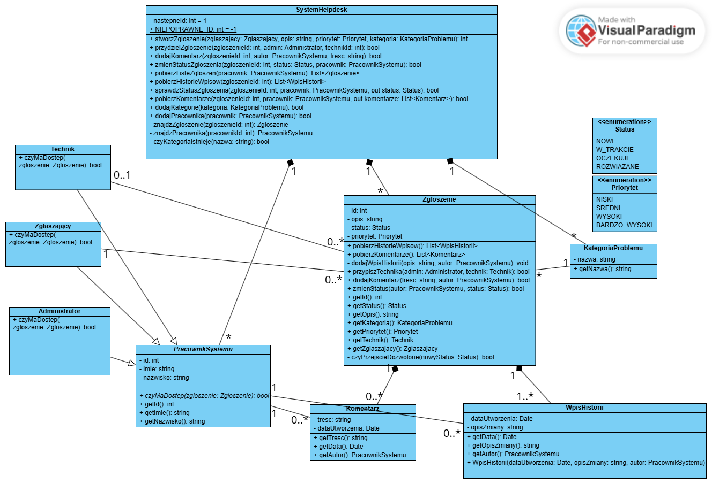
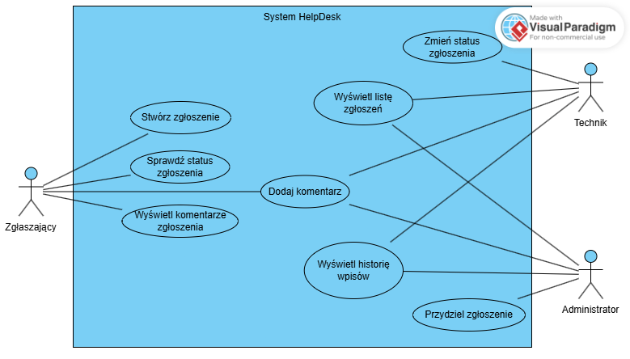

# System Obsługi Zgłoszeń IT (Helpdesk)

Cyberbezpieczeństwo – Programowanie obiektowe, Politechnika Poznańska, 2026/2027

Autorzy: Dawid Kropiewnicki & Teofil Stefko

System Obsługi Zgłoszeń IT to aplikacja konsolowa, która pozwala zgłaszać
problemy techniczne i śledzić, co się z nimi dzieje. Zgłaszający tworzy
zgłoszenie z opisem, priorytetem i kategorią, a potem może sprawdzić jego status
i przeczytać komentarze. Administrator widzi wszystkie zgłoszenia i przydziela
je technikom. Technik zajmuje się tylko swoimi zgłoszeniami: zmienia ich status
(Nowe, W trakcie, Oczekuje, Rozwiązane) i dodaje komentarze, podobnie jak inni
użytkownicy, którzy mają dostęp do zgłoszenia. Każda zmiana zapisuje się
automatycznie w historii zgłoszenia razem z datą i autorem, więc zawsze wiadomo,
kto i kiedy coś zrobił.

Pełna lista User Stories: [docs/user_stories.md](docs/user_stories.md).

## Wymagania

- g++ z obsługą C++17 (GCC 7 lub nowszy)

## Kompilacja i uruchomienie

```bash
g++ -std=c++17 -Wall -Wextra -Iinclude src/*.cpp -o helpdesk
./helpdesk
```

## Struktura projektu

| Katalog    | Zawartość                                                   |
|------------|-------------------------------------------------------------|
| `include/` | pliki nagłówkowe – po jednym na klasę                       |
| `src/`     | implementacja klas; `main.cpp` – demonstracja wszystkich US |
| `docs/`    | dokumentacja projektu (szczegóły niżej)                     |

## Dokumentacja

| Plik                                                   | Zawartość                       |
|--------------------------------------------------------|---------------------------------|
| [docs/user_stories.md](docs/user_stories.md)           | opis systemu i User Stories     |
| [docs/use_cases.txt](docs/use_cases.txt)               | opis przypadków użycia          |
| [docs/diagram_sekwencji.md](docs/diagram_sekwencji.md) | opis diagramu sekwencji         |

Diagramy UML w katalogu [docs/diagramy/](docs/diagramy/) – każdy jako plik
Visual Paradigm (`.vpd`) i obraz (`.png`):

| Diagram           | Obraz                                                                   | Plik źródłowy                                                           |
|-------------------|-------------------------------------------------------------------------|-------------------------------------------------------------------------|
| Klas              | [helpdesk-class-diagram.png](docs/diagramy/helpdesk-class-diagram.png)         | [helpdesk-class-diagram.vpd](docs/diagramy/helpdesk-class-diagram.vpd)         |
| Przypadków użycia | [helpdesk-use-cases-diagram.png](docs/diagramy/helpdesk-use-cases-diagram.png) | [helpdesk-use-cases-diagram.vpd](docs/diagramy/helpdesk-use-cases-diagram.vpd) |
| Sekwencji         | [diagram_sekwencji.png](docs/diagramy/diagram_sekwencji.png)                   | [diagram_sekwencji.vpd](docs/diagramy/diagram_sekwencji.vpd)                   |

Katalog `docs/diagramy/prev-class-diagrams/` zawiera wcześniejsze wersje
diagramu klas.

### Diagram klas



### Diagram przypadków użycia


